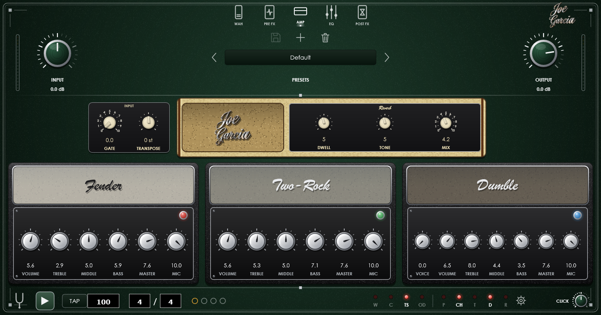
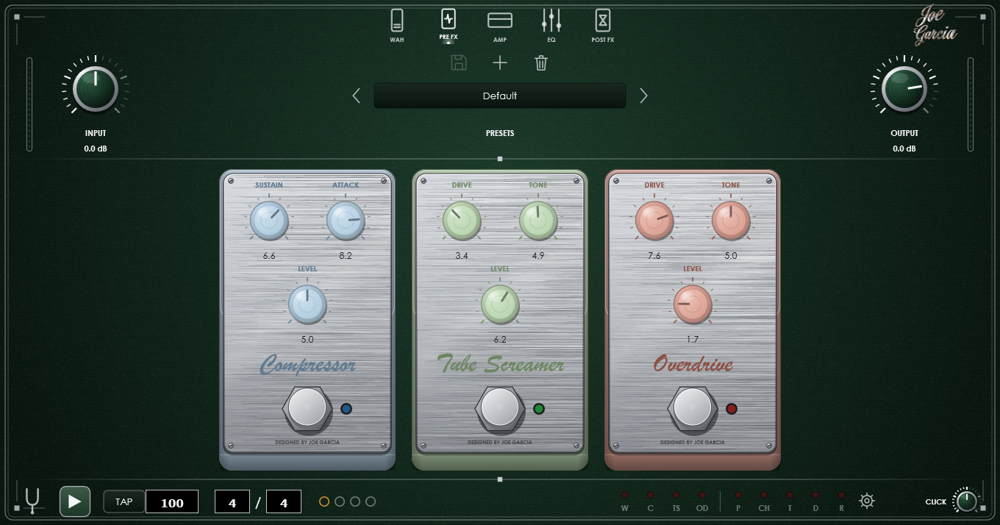
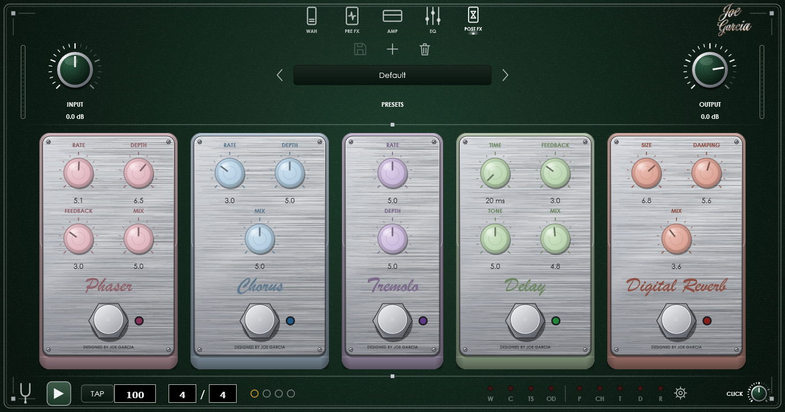
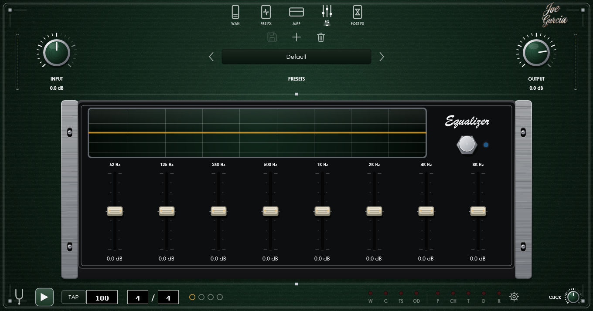

# Joe Garcia Rig

A guitar amp and pedalboard plugin (VST3) and standalone app, built with [JUCE](https://juce.com) and CMake: three amp
heads in parallel (Fender, Two-Rock and Dumble), a Fender spring reverb unit feeding them, real cabinet IRs, and NAM
captures of a Dumble, a TS9 and a Boss SD-1.



## Features

**Amps**
- Three heads playing at once, John Mayer style, each with its own power switch and VOLUME, TREBLE, MIDDLE, BASS,
  MASTER and MIC knobs. Turning heads on or off keeps the overall loudness about the same.
  - **Fender**: a Twin Reverb modelled from its circuit (12AX7 preamp, tone stack, bright cap, power amp with sag).
  - **Two-Rock**: modelled the same way, with its own tone stack values.
  - **Dumble**: a NAM capture of a Dumble ODS #102. The VOICE knob moves through 66 captures from clean (CLN KLEAN)
    to driven; hover over it to see the capture's name.
- Each head plays through recorded cabinet IRs: a Fender Twin cab for the Fender, a Two-Rock 2x12 (65B) for the
  Two-Rock and the Dumble. MIC blends three microphones on the cab.
- A Fender spring reverb unit on top feeds all three heads: DWELL and TONE pick from 100 recorded spring tank IRs,
  MIX sets the level. A GATE and a TRANSPOSE (pitch shift) sit next to it.

**Pedals**
- Pre amp: wah (manual or auto), compressor, **Tube Screamer** (plays Ibanez TS9 captures; DRIVE picks the closest),
  **Overdrive** (plays Boss SD-1 captures; DRIVE goes through Boost I–III, then Drive I–VI).
- After the amps: phaser, chorus, tremolo, delay, digital reverb, and an 8-band graphic EQ.
- **Auto level**: stacking the compressor and drive pedals can't make the amps more than about 6 dB louder than your
  clean sound, so a pedal still pushes the amp but doesn't jump out. It can be turned off in the settings (gear) menu.
  A limiter on the output catches the rest.
- **Pedal lamps** in the footer (W C TS OD | P CH T D R) show which pedals are on from any view; click one to switch it.





**Everything else**
- Presets: save, rename, delete, step through with the arrows. A preset named **Default** loads in every new instance.
  The factory presets are Init, Mayer Clean, SRV Edge and Dumble Klean.
- Chromatic tuner, metronome with tap tempo and time signatures, input and output volume with level meters.
- Keyboard shortcuts (the full list is in the gear menu):

  | Keys | Action |
  | --- | --- |
  | Q W E R | wah, compressor, Tube Screamer, Overdrive |
  | A S D F G | phaser, chorus, tremolo, delay, digital reverb |
  | 1 2 3 | Fender, Two-Rock, Dumble heads |
  | Left / Right | previous / next preset |
  | T | tuner |
  | Space | metronome |

The captures are recorded at 48 kHz and aren't resampled: run your audio interface at 48 kHz.

## Build (Windows)

You need Git, CMake and the Visual Studio 2022 C++ build tools. JUCE, the NAM engine and Eigen are downloaded
automatically.

```
git clone https://github.com/ric4r2/guitar-plugin.git
cd guitar-plugin
cmake -S . -B build -G "Visual Studio 17 2022" -A x64
cmake --build build --config Release
```

The standalone app and the VST3 end up under `build/GuitarDrive_artefacts/Release/`.

Everything the build needs is in this repository, including the recorded IRs and NAM captures, so a fresh clone on a
new computer builds the full plugin.

### The recorded IRs and NAM captures (private)

`Assets/private-ir/` holds the packed sounds the build embeds into the program:

- `irs.bin`: the cabinet IRs and the 100 spring tank IRs
- `nam.bin`: the Dumble, TS9 and SD-1 captures
- `source/`: the original downloads they were made from. The Fender Spring Reverb Tank zip is split into
  `.001`–`.005` parts, because GitHub doesn't accept files over 100 MB.

They are licensed for personal use only. That's why this repository is **private**: don't make it public or share
builds made with them. Without the two `.bin` files the plugin still builds, with built-in cabinet models, the
algorithmic spring and the circuit-modelled pedals instead.

To rebuild the packs (only needed after changing the packing scripts or the downloads):

```
python tools/pack_irs.py
python tools/pack_nam.py
```

### ASIO (optional, for low latency in the standalone app)

Download Steinberg's ASIO SDK yourself (it is not included here) and point CMake at its `ASIOSDK` folder:

```
cmake -S . -B build -DASIO_SDK_DIR="C:/path/to/ASIOSDK"
```

### Tests and screenshots

The offline DSP tests (amps, IRs, captures, auto level, presets and more) and the screenshot tool are separate targets:

```
cmake -S . -B build -DGUITARDRIVE_BUILD_TESTS=ON
cmake --build build --config Release --target GuitarDriveTests GuitarDriveSnapshot
build/GuitarDriveTests_artefacts/Release/GuitarDriveTests.exe
```

`GuitarDriveSnapshot <folder>` renders each view to a PNG (the images in this README come from it).

## Layout

- `Source/` the plugin: `ChannelStrip` (the signal chain), `AmpModel` (the circuit-modelled heads), `CabinetIR` and
  `IRPack` (cabinets and spring tank), `NamCapture` (the NAM captures), `Effects`, `Presets`, the editor and widgets
- `Tests/` the DSP tests and the screenshot tool
- `tools/` the scripts that pack the IRs and captures
- `docs/SOUND_MODELS.md` what is modelled from real circuits, the component values and the sources
- `Assets/` the logo and the private sounds

## License

The code is under the GNU Affero General Public License v3.0 (see [LICENSE](LICENSE)), the license JUCE is used
under. The recorded IRs and NAM captures in `Assets/private-ir/` are not covered by it: they belong to their makers and
are for personal use only.
